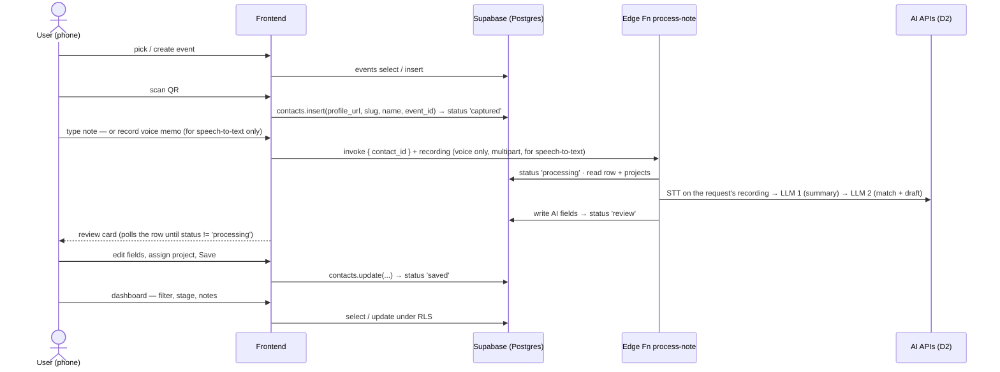

# Backend brief — build & wiring instructions (Phase 1)

> For Utkarsh (backend/AI) + Nodir (frontend wiring). 24 Oct.
> Architecture: [ARCHITECTURE.md §2](ARCHITECTURE.md) · data model: [DATA_MODEL.md](DATA_MODEL.md) · schema: [../supabase/migrations/0001_phase1_schema.sql](../supabase/migrations/0001_phase1_schema.sql) · AI prompts spec: [../PRD.md §9](../PRD.md)
> **Today's gate (M3, Sat midday): scan → note → AI fields visible on screen, with real AI calls.**
> Naming: the processing step appears here as the `process-note` Edge Function; if D1 lands on a separate server instead, the identical contract applies to `POST /api/contacts/:id/process` from the [IMPLEMENTATION_PLAN build map](../IMPLEMENTATION_PLAN.md) (step 6) — same inputs, statuses and writes.

## 1. The user journey, mapped to backend calls

| Step | Frontend does | Backend / service | Writes (see DATA_MODEL §1) |
|---|---|---|---|
| Pick event | list + create form | Postgres `events` | name, location, url, starts_on |
| Scan | html5-qrcode decode → regex slug → prettify name | Postgres `contacts` insert | source, profile_url, profile_slug, name, event_id, `status='captured'` |
| Quick project pick (optional) | one-tap chips | Postgres update | project_id, `project_set_by='user'` |
| Note | textarea **or** MediaRecorder (speech-to-text only — **no audio file is saved**) | — | note_kind, note_text (typed; voice transcript lands in processing) |
| Processing | invoke fn, then poll row every 2 s | **Edge Fn `process-note`** → AI APIs | summary, discussed, needs, project_id, match_reason, match_confidence, next_step, next_step_date, follow_up_draft, `status='review'` |
| Review & save | editable card | Postgres update | edited fields, `status='saved'`; project change → `project_set_by='user'` |
| Dashboard | table + drawer | Postgres select/update | stage, user_notes, any field |

## 2. Tools — what's connected, what's needed, where

| Tool / service | Used for | Where it runs | Key / setup | Owner | Status |
|---|---|---|---|---|---|
| **Supabase** (Postgres, Auth, Edge Functions) | all data, RLS, AI pipeline | cloud | create project (EU region); anon key → client, service-role stays server-side (auto-injected in Edge Fns) | Utkarsh | ❌ create today |
| **supabase-js** | the 4 data calls from both pages | browser | CDN or npm; replaces `data.js` internals | Nodir + Utkarsh | ❌ |
| **Supabase CLI** | apply migration, deploy Edge Fn, set secrets | dev laptops | `supabase login`, `supabase link` | Utkarsh | ❌ |
| **AI provider** (per D2, mentor key) | STT (voice→text) · LLM call 1 (summary) · LLM call 2 (match + draft) · vision only if D4 stays in | **Edge Function only** — never the browser | `supabase secrets set AI_API_KEY=...` | Utkarsh | ❌ |
| **html5-qrcode** | camera QR decode (D3) | phone page | CDN script | Nodir | ✅ wired in the prototype (camera needs HTTPS on the phone) |
| **MediaRecorder API** | voice memo | phone page | built-in; ⚠️ Safari records `audio/mp4`, Chrome `audio/webm` — send the recording with its actual mimeType. Used for speech-to-text only | Nodir | — |
| **HTTPS static hosting** (D9: Vercel/Netlify) | serve the two pages; camera+mic require HTTPS | cloud | one-command deploy | Utkarsh | ❌ today |
| GitHub | repo + submission (M6) | — | all 5 have access | Nodir | ✅ |
| ~~Notion API, OAuth, pg_cron, webhooks/queues~~ | **Phase 2 — do not set up this weekend** ([ARCHITECTURE.md §3](ARCHITECTURE.md)) | — | — | — | parked |

### Keys and env

| Where | Variable | Notes |
|---|---|---|
| Client (gitignored `config.js` or build env) | `SUPABASE_URL`, `SUPABASE_ANON_KEY` | anon key is safe client-side **because RLS is on** |
| Client | `DEMO_EMAIL`, `DEMO_PASSWORD` | single demo user (D6); sign in on page load so `auth.uid()` works |
| Edge Fn secrets | `AI_API_KEY` | the mentor's key; never in the repo (AC-2.2) |
| Edge Fn (auto) | `SUPABASE_URL`, `SUPABASE_SERVICE_ROLE_KEY` | injected by Supabase |

## 3. Build & wiring order (do it in this sequence)

- [ ] **1. Supabase project** (EU region). Save URL + anon key into the gitignored client config.
- [ ] **2. Apply schema + demo user.** `supabase db push` (migration 0001). Create the demo auth user. Smoke-test RLS: a second user must see zero rows.
- [ ] **3. Seed** (with Bhuvanesh): 1 event, 4–5 projects **with 1–2-sentence descriptions** (the AI matches on `name + description`), fake personas (P-6).
- [ ] **4. Swap `data.js` → supabase-js** (with Nodir): keep the exact four function signatures (`db.list/insert/update`, projects list) from [DATA_MODEL.md §3](DATA_MODEL.md) so no screen code changes. Sign in the demo user on load.
- [ ] **5. Voice memo → speech-to-text:** the client sends the recording in the `process-note` request body (multipart, actual mimeType); set `note_kind='voice'`. It is transcribed into `note_text`; no audio file is saved anywhere.
- [ ] **6. Edge Fn `process-note` skeleton first:** statuses + error path before any AI — set `processing`, fake fields, set `review`; on throw set `status='error'` (keeps fields and transcript; Retry runs from the text, P-5). Frontend polls the row every 2 s.
- [ ] **7. Wire the AI** inside the fn, in order: STT → `note_text`; LLM 1 → summary JSON; `projects` select (`archived=false`); LLM 2 → match + confidence + follow-up draft. JSON schemas + rules: [PRD.md §9](../PRD.md). If `project_set_by='user'`, don't overwrite `project_id`. Invalid JSON → one retry → else `error`. Prompts live in the repo (`/prompts`) — AC-6.5.
- [ ] **8. Idempotency:** re-invoking on the same contact must be safe (retry button).
- [ ] **9. Deploy** both pages to the HTTPS host; test camera + mic **on the demo phone** (D10), not just desktop.
- [ ] **10. Measure:** log seconds + tokens per step; hand real €/contact to Sadaf (AC-7.4). Then: 3 clean runs in a row (AC-4.1).

## 4. Acceptance checks for the wiring

| Check | Target | AC |
|---|---|---|
| Scan → row visible | < 3 s | P-1 |
| Note → review card | ≤ 15 s | P-2 |
| Unknown fields | empty, never invented | P-2 |
| AI/STT failure | message + retry, nothing lost | P-5 / FR-10 |
| Whole flow | no developer intervention | AC-3.2 |
| Stability | 3 runs in a row clean | AC-4.1 |
| Keys | none in repo or client bundle | AC-2.2 / P-6 |
